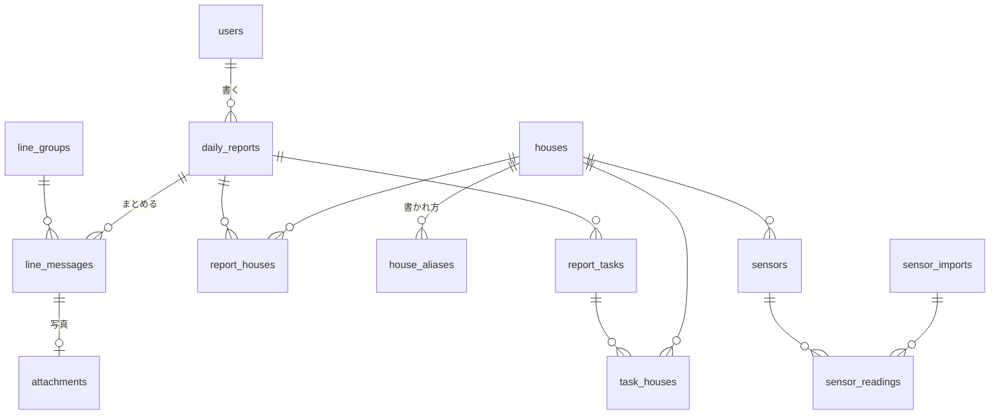

# DB設計（Supabase）

`migrations/0001_init.sql` を Supabase の SQL Editor に貼り付けて実行すると、テーブル16個と写真用の非公開バケット `line-attachments` ができる。

## 方針

- **元の本文は書き換えない**：日報の本文は `daily_reports.body` と `line_messages.text` にそのまま残す。AIの読み取り結果は別テーブルに入れるので、読み取り方を直したら過去分も読み直せる。
- **日報とハウスは中間テーブル**：1件の日報に複数のハウスが出てくる（実際の日報の約4割）ため、`report_houses` でつなぐ。作業ごとにハウスが違う場合は `task_houses`。
- **ハウス一覧はAIが育てる**：最初は空でよい。AIが日報から見つけたハウスは `status='candidate'`（候補）で入り、人が確認したら `confirmed`。同じものだと分かったら `merged_into` で統合する。書かれ方（A3／A-3／A棟3）は `house_aliases.normalized` で照合する。
- **時刻は `timestamptz`**：UTCで保存し、表示は日本時間。`report_date` だけは日本時間の日付。
- **RLSを全テーブルで有効（ポリシーなし）**：ブラウザ用の anon キーからは一切読めない。ボット（サーバー）はDB直結の接続文字列か service_role キーで読み書きする。React画面は必ずFastAPIを通す。

## テーブル

| まとまり | テーブル | 中身 |
|---|---|---|
| 人 | `users` | 表示名、日報ボット側のID、管理ボット側のID、権限（admin / staff） |
| | `line_groups` | ボットが入っているグループ（日報 / 管理者 / テスト） |
| 日報 | `line_messages` | LINEのメッセージ1件ずつ（文字・写真・ファイル）の元データ |
| | `daily_reports` | 同じ人の続けての投稿を1件にまとめた日報。AI読み取りの状態も持つ |
| | `attachments` | 写真・ファイル。実体は Storage の `line-attachments` |
| ハウス | `houses` | ハウス・露地の一覧（確定 / 候補） |
| | `house_aliases` | 書かれ方（表記ゆれ）→ どのハウスか |
| | `report_houses` | 日報 × ハウス（書かれていた表記・推定かどうか） |
| | `report_tasks` | 日報から読み取った作業（作業日、次フェーズ用の数量・作業時間） |
| | `task_houses` | 作業 × ハウス |
| センサー | `sensors` | ファーモの機器ID → ハウス |
| | `sensor_imports` | 取り込んだCSVファイル |
| | `sensor_readings` | 計測値（機器×時刻で重複しない） |
| 気象 | `weather_obs` | アメダスの10分値 |
| 運用 | `question_logs` | 管理ボットへの質問と回答。答えられなかった質問＝日報に足りない情報 |
| | `weekly_reports` | 週次レポートの送信記録（二重送信の防止） |



## Storage のパス

```
line-attachments/
  groups/<グループID>/<日付>/<メッセージID>.jpg   日報の写真・ファイル
  sensor-csv/<日付>/<ファイル名>.csv              ファーモのCSV
```

## 接続

- Cloud Run からは **接続プーラー（Supavisor）のURL** を使う（直接接続はIPv6のみのため）。
  Supabase の Project Settings → Database → Connection string → 「Session pooler」
- `DATABASE_URL`・`SUPABASE_URL`・`SUPABASE_SERVICE_KEY` は `.env.report` / `.env.assistant` と Secret Manager に入れる。GitHubには上げない。

## 次の変更の入れ方

テーブルを変えるときは `migrations/0002_xxx.sql` のように番号を増やして追加する（`0001` は書き換えない）。
